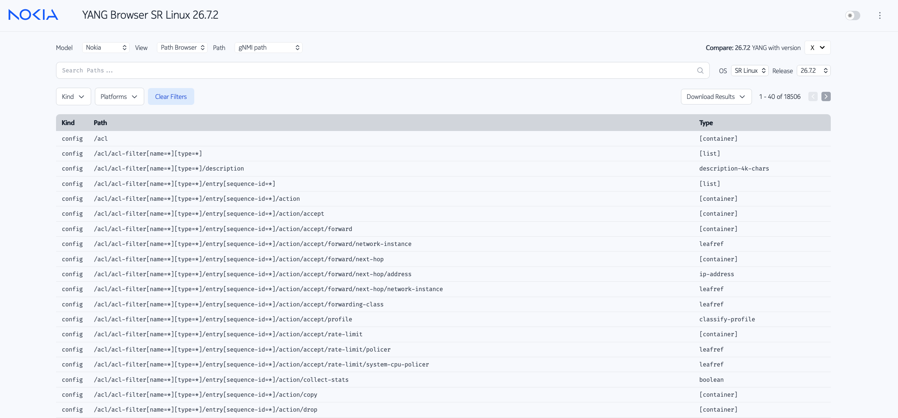
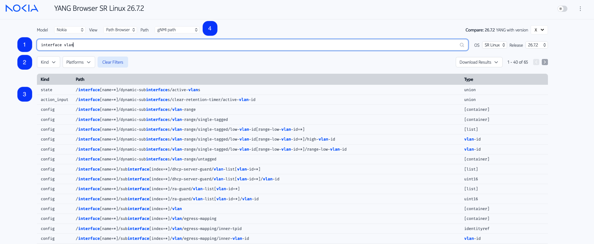
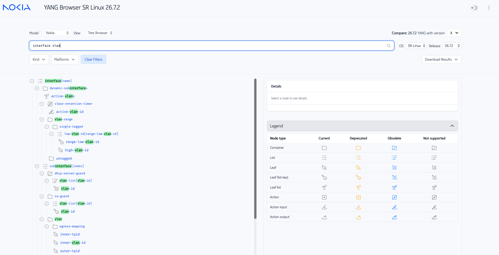

# SR Linux YANG Browser

YANG data models are the map one should use when looking for their way to configure or retrieve any data on SR Linux system. A central role that is given to [YANG in SR Linux](index.md) demands a convenient interface to **browse**, **search** through, and **process** these data models.

To answer these demands, we created a web portal - [**yangbrowser.nokia.com/srlinux**][yang-portal] - it offers:
[yang-portal]: https://yangbrowser.nokia.com/srlinux

* Fast [Path Browser](#path-browser) to effectively search through thousands of available YANG paths
* Beautiful [Tree Browser](#tree-browser) to navigate the tree representation of the entire YANG data model of SR Linux
* Source `.yang` files neatly stored in [`nokia/srlinux-yang-models`][yang-models-gh] repository for programmatic access and code generation

The web portal's opens on the latest release and the navigation options in the top right allow the selection of alternate release.

<figure markdown>
  
</figure>

The main stage of the YANG Browser view is dedicated to the Path Browser as it is the most efficient way to search through the model. Additional tools are located in the header. Let's cover them one by one.

## Path Browser

As was discussed before, SR Linux is a fully modeled system with its configuration and state data entirely covered with YANG models. Consequently, to access any data for configuration or state, one needs to follow the YANG model. Effectively searching for those YANG-based access paths is key to rapid development and operations. For example, how to tell which one to use to get ipv4 statistics of an interface?

With Path Browser, it is possible to search through the entire SR Linux YANG model and extract the paths to the leaves of interest. The Path Browser area is composed of a few key elements:

* search input for entering the query :material-numeric-1-circle:
* Kind selector :material-numeric-2-circle:
* table with results for a given search input :material-numeric-3-circle:
* path format selector :material-numeric-4-circle:

<figure markdown>
  
  <figcaption>Path Browser elements</figcaption>
</figure>

A user types in a search query, and the result is rendered immediately in the table with the matched words highlighted. The Kind selector allows users to select if they want the table to show config, state, actions, action inputs, action outputs, or all nodes. The state leaf is a leaf that has `config false` statement[^2].

### Path structure

The table contains the flatted YANG path information which is available in a variety of YANG path formats.

* JSON instance path: A JSON encoded self-describing YANG path that includes the YANG model, augmentations and list keys.  This format is useful for programming.
* gNMI path: An XPATH-like format[^3] suitable for gNMI subscriptions.
* Xpath: The formal Xpath path specification.
* Model path: A RESTCONF-like format for use with automation system APIs such as Nokia's Network Services Platform (NSP).
* JS path: A JSON encoded path for use with traditional JSON tools such as `jq`.

Clicking on a path provides the metadata associated with the YANG path.

### Search capabilities

Snappy search features of the Path Browser make it a joy to use when exploring the model or looking for a specific leaf of interest.

Let's imagine we need to solve the simple task of subscribing to interface traffic statistics. How would we know which gNMI path corresponds to the traffic statistics counters?  
Should we try reading source YANG files? But it is challenging as models have lots of imports and quite some augmentations. A few moments and - you're lost.  
What about the tree representation of a model generated with [`pyang`][pyang_gh]? Searching through something like pyang's tree output is impractical since searching the tree representation can't include more than one search parameter. The search becomes a burden on operators' eyes.

Path Browser to the rescue. Its ability to return search requests instantaneously makes interrogating the model a walk in the park. The animation below demos a leaf-searching exercise where a user searches for a state leaf responsible for traffic statistics.  

First, a user tries a logical search query `interface byte`, which yields some results, but it is easy to spot that they are not related to the task at hand. Thanks to the embedded highlighting capabilities, the search inputs are detectable in the resulting paths.

Next, they try to use `interface octets` search query hoping that it will yield the right results, and so it does!

## Tree Browser

The Path Browser is great to search through the entire model, but because it works on flattened paths, it hides the "tree" view of the model. Sometimes the tree representation is the best side to look at the models with a naked eye, as the hierarchy becomes very clear.

To not strip our users of the beloved tree view mode, we enhanced the `pyang -f jstree` output and named this view Tree Browser.

The tree view of the model offers a step-by-step exploration of the SR Linux model going from the top-level modules all the way down to the leaves. The tree view displays the node's type (leaf/container/etc) as well as the leaf type and the read-only status of a leaf.

<figure markdown>
  
  <figcaption>Tree Browser view</figcaption>
</figure>

[yang-models-gh]: https://github.com/nokia/srlinux-yang-models
[pyang_gh]: https://github.com/mbj4668/pyang

[^1]: extracted with `pyang -f tree`
[^2]: refer to https://datatracker.ietf.org/doc/html/rfc6020#section-4.2.3
[^3]: paths are generated from the YANG model with [gnmic](https://gnmic.openconfig.net/cmd/path/)
